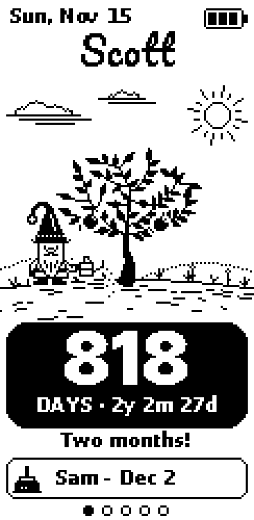

# Sobergotchi

A pocket e-paper companion for people working a 12 step program. A tree grows with your sober time, today's reflection is one button away, and friends are added by touching two devices back to back.



## Hardware

| Part | Notes |
| --- | --- |
| Seeed Studio XIAO ePaper Display Board **EN05** | XIAO nRF52840 Plus, 3 buttons, charger, power switch, 24-pin e-paper connector |
| GDEY0213B74 2.13" e-paper | 122 x 250, black and white, SSD1680 |
| Reed switch | between **D0** and **GND** (normally open) |
| Small magnet | behind the back-left corner; the reed sits behind the back-right corner at the same height |
| LiPo, 3.7 V 200 mAh | JST 2.0 connector on the EN05 |

Hold two Sobergotchis back to back, both upright with screens facing out: each magnet lands on the other's reed switch and both wake to swap cards. Pins live in `firmware/sobergotchi/src/config.h` if your reed is on a different pin.

## Buttons

| | Left (D2) | Middle (D9) | Right (D1) |
| --- | --- | --- | --- |
| Moving between screens | previous screen | select (turn the page on Reflection) | next screen |
| In a list | up | open / change | down |
| Editing a date | minus | next field (the last one saves) | plus |
| Editing a name or phone | previous letter | next position | next letter |

Hold the middle button to go back (in the name/phone editor, holding it saves). After 30 seconds without a press the device returns to the home screen and sleeps.

## Screens

Home (tree, name, days, next friend anniversary), Reflection, Friends, Settings, plus a friend card, editors, "Friend added", rock-paper-scissors when two friends meet again, and a celebration screen on your anniversary (and at 30, 60, 90 days, 6 and 9 months).

All screens are in `screens/*.sml`, a small HTML-like markup. See [docs/screen-markup.md](docs/screen-markup.md). Every screen has a true-size preview in `preview/`.

## Building the firmware (Arduino IDE)

1. In **File > Preferences > Additional boards manager URLs** add
   `https://files.seeedstudio.com/arduino/package_seeeduino_boards_index.json`
2. **Boards Manager**: install **Seeed nRF52 Boards** (not the "mbed-enabled" one).
3. **Library Manager**: install **GxEPD2** (Jean-Marc Zingg) and **Adafruit GFX Library**.
4. Open `firmware/sobergotchi/sobergotchi.ino`, choose **Tools > Board > Seeed XIAO nRF52840 Plus**, and upload.
   If upload fails, double-press the side Reset button to enter the bootloader and try again.

The first start uses the defaults at the top of `config.h` (name and sobriety date); change them later in Settings. The clock starts at the time the firmware was compiled, so set **Settings > Today** if the device has been off.

## Changing screens, fonts or art

The firmware draws from generated tables in `firmware/sobergotchi/src/generated/`. After editing `screens/`, `fonts/` or `art/`:

```
python tools/build_ui.py
```

This needs Python 3 with Pillow (`pip install pillow`), and for SVG art Node.js with Playwright (`npm install playwright` then `npx playwright install chromium`). It rewrites the generated headers and the PNGs in `preview/`. `python tools/make_tree_art.py` regenerates the 26 tree drawings in `art/tree/` (it overwrites hand edits).

## Power

The chip sleeps between events with the radio off. The screen does one full refresh just after midnight and fast partial refreshes while you press buttons. Sleep current still needs measuring on real hardware.

## Credits

Fonts: Inter, Lora, Pacifico and Great Vibes (SIL Open Font License), DejaVu Sans (Bitstream Vera license). Daily reflections, the handshake and rock-paper-scissors art come from the original Sobagotchi project.
